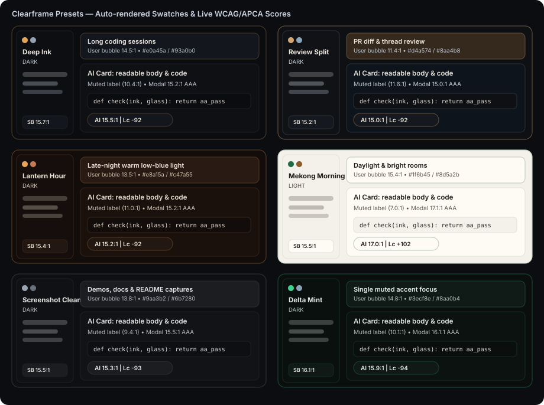

# Clearframe (`agy-readglass`)

> Theme kính cho Antigravity theo ca làm việc — chữ vẫn đọc rõ cả buổi.
>
> *Work-session glass themes for Antigravity, contrast-verified for 8-hour readability.*

[](https://github.com/vuloc080611/agy-readglass/actions/workflows/validate.yml)
[](./LICENSE)
[](./src/clearframe_core)

---

## Vấn đề & Cách Clearframe giải quyết

Nhiều theme kính cho Antigravity trông bắt mắt khi vừa mở nhưng chỉ sau 20 phút code hoặc review diff, chữ trên sidebar, timestamp và thẻ AI bị chìm vào nền hoặc phát sáng gây mỏi mắt (halation — đặc biệt với chữ tiếng Việt có dấu `ệ, ợ, ẫ, ữ`).

**Clearframe** là bộ **preset pack + bộ công cụ kiểm toán/cứu độ đọc + 3 Agent Skills** không đụng vào binary hay engine:

- **6 preset theo ca làm việc:** không chạy theo wallpaper anime hay glow neon.
- **Chuẩn Đọc 4 Lớp:** kiểm toán bắt buộc bằng **WCAG 2.1** (blend qua `overlayRgb` & kiểm tra mọi stop của gradient), **APCA 0.98G**, **cảnh báo Anti-Halation**, và **tách lớp thân thiện Deuteranopia / Night Light**.
- **Cứu theme có sẵn (`audit_repair.py`):** giữ nguyên ảnh nền và gu màu của bạn trong `themes.json`, chỉ nâng vừa đủ độ đục thẻ hoặc chỉnh mực chữ để vượt chuẩn AA.
- **Đóng gói 0 phụ thuộc ngoài:** toàn bộ script dùng Python stdlib thuần, không Pillow, không Cargo, không `backdrop-filter`.



*(Hình trên là SVG swatch & số đo WCAG/APCA được sinh tự động từ `themes/themes.json` bằng `tools/render_swatches.py`. Bạn có thể dùng trực tiếp [Interactive Web Studio](https://vuloc080611.github.io/agy-readglass/) hoặc mở file cục bộ [docs/index.html](docs/index.html) trên trình duyệt để thử chuyển 6 preset, thả ảnh nền cá nhân, bật mô phỏng mù màu/Night Light và xuất `pack.json` ngay lập tức.)*

---

## 6 Preset theo ca làm việc

| Preset | Ca làm việc | Dark / Light | Accent chính / phụ | Ornament |
| --- | --- | --- | --- | --- |
| **Deep Ink** *(mặc định)* | Code tập trung nhiều giờ | Dark | `#e0a45a` / `#93a0b0` | Không |
| **Review Split** | Đọc diff & thread dài (User ấm, AI lạnh + tách độ sáng) | Dark | `#d4a574` / `#8aa4b8` | Không |
| **Lantern Hour** | Làm việc buổi tối, ánh sáng ấm giảm xanh | Dark | `#e8a15a` / `#c47a55` | `assets/lantern-mark.svg` |
| **Mekong Morning** | Ban ngày / phòng sáng, nền giấy ấm mực than | Light | `#1f6b45` / `#8d5a2b` | Không |
| **Screenshot Clean** | Quay video demo, chụp ảnh README, không glow | Dark | `#9aa3b2` / `#6b7280` | Không |
| **Delta Mint** | Một accent mint trầm trên nền than trung tính | Dark | `#3ecf8e` / `#8aa0b4` | Không |

### Bảng Contrast thực tế (chạy bằng `python tools/check_contrast.py --apca --strict-ergo`)

```text
Preset               Sidebar   AI Card    Modal   Bubble    Muted   Glow  APCA(AI)  Status
------------------------------------------------------------------------------------------
Deep Ink               15.71     15.48    15.22    14.54    10.38   0.14     -92.1    PASS
Review Split           15.24     15.04    14.96    11.43    11.63   0.10     -91.8    PASS
Lantern Hour           15.45     15.15    15.20    13.48    10.97   0.16     -91.7    PASS
Mekong Morning         15.52     17.00    17.07    15.42     7.05   0.12    +102.3    PASS
Screenshot Clean       15.54     15.30    15.53    13.82     9.42   0.06     -92.8    PASS
Delta Mint             16.14     15.91    16.07    14.78    10.14   0.14     -94.4    PASS
```

---

## Cài đặt nhanh trong 3 bước (đã có `agy-theme`)

Nếu bạn đã cài sẵn engine Rust `agy-theme`:

1. **Sao chép trọn bộ preset** `themes/themes.json` (và `themes/assets/lantern-mark.svg` vào `themes/assets/`) sang bản cài `agy-theme` của bạn — **hoặc** dùng script cài an toàn chỉ 1 preset lẻ:
   ```bash
   python tools/install_pack.py --pack themes/packs/deep-ink.json --target <path-to-agy-theme>/themes.json --set-default
   ```
2. **Build trong thư mục engine `agy-theme`:**
   ```bash
   agy-theme build
   ```
3. **Mở lại Antigravity:** Quit hoàn toàn Antigravity (kể cả khay hệ thống) và mở lại từ shortcut đã gắn cờ `--remote-debugging-port=0`. Nhấn `Alt + Shift + T` để đổi qua lại giữa 6 preset.

> **Chưa có engine?** Cài đặt `agy-theme` từ repo [chinhzz108/antigravity-custom-theme-rust](https://github.com/chinhzz108/antigravity-custom-theme-rust) theo hướng dẫn của tác giả (nhớ gắn flag `--remote-debugging-port=0` vào shortcut và Quit hẳn app trước khi khởi chạy lại). Clearframe không chứa engine Rust, không `Cargo.toml` và không sửa `app.asar`.

---

## Các tính năng nổi bật đi kèm

### 1. Cứu bộ theme wallpaper sẵn có (`audit_repair.py`)
Bạn thích ảnh nền hiện tại nhưng sidebar/AI card không đọc được? Chạy kiểm toán & sửa tối thiểu (tự tạo file `.bak`):
```bash
python tools/audit_repair.py --input <path-to>/themes.json --in-place --fix
```

### 2. Phân tích vùng sáng ảnh nền & Sinh theme OKLCH từ ảnh/màu
```bash
# Đo vùng sáng 22% trái (Sidebar) và 78% phải (Chat) của ảnh PNG/BMP/PPM
python tools/analyze_wallpaper.py path/to/wallpaper.png --mode dark

# Sinh một preset mới dịu mắt trên không gian màu OKLCH và tự vượt cổng AA
python tools/scaffold_theme.py --name "Rainy Porch" --primary "#d4a574" --secondary "#8aa4b8" --output themes/packs/rainy-porch.json
```

### 3. Đồng bộ màu cho Antigravity IDE (`export_ide_sync.py`)
Tạo block `"workbench.colorCustomizations"` khớp màu với chat card, tự động nâng độ rõ scrollbar (`>= 3:1`) và hỗ trợ `--cvd-safe` (diff Xanh lam / Hổ phách cho người khiếm khuyết sắc giác):
```bash
python tools/export_ide_sync.py --preset "Deep Ink" --cvd-safe
# Hoặc kiểm tra đường dẫn settings chuẩn của Antigravity (chỉ đọc):
python tools/doctor.py
```

### 4. Đổi preset theo ca làm việc & Hỗ trợ định dạng `mod-v2`
```bash
# Tự chọn Mekong Morning (sáng) / Deep Ink (chiều) / Lantern Hour (tối) hoặc chỉ định --shift
python tools/shift_preset.py --shift night --target <path-to>/themes.json

# Xuất định dạng cho antigravity-custom-theme-mod (defaultTheme + presets)
python tools/sync_packs.py --format mod-v2 --output dist/themes-mod-v2.json
```

---

## Cài đặt Agent Skills cho Antigravity / Cursor / Claude Code

Repo cung cấp 3 skill độc lập đặt trong `skills/`:
- `clearframe-theme`: Chọn preset theo ca làm việc hoặc tạo theme mới từ ảnh/mood qua cổng AA/APCA.
- `clearframe-audit`: Kiểm toán và sửa lỗi đọc trên bất kỳ file `themes.json` nào.
- `clearframe-ide-sync`: Xuất cấu hình màu editor, tabs, terminal, scrollbar và diff khớp preset.

**Cách cài:**
- Qua Antigravity Plugin CLI: `agy plugin install https://github.com/vuloc080611/agy-readglass`
- Qua `skills.sh` CLI: `npx skills add vuloc080611/agy-readglass`
- Hoặc copy thư mục `skills/clearframe-theme` (cùng `clearframe-audit`, `clearframe-ide-sync`) vào `.agents/skills/` hoặc `~/.gemini/antigravity/skills/`.

**Ví dụ prompt:**
- *"Đổi sang preset Review Split để đọc thread và diff rõ hơn."*
- *"Làm cho tôi một theme buổi sáng từ ảnh này nhưng bắt buộc đạt WCAG AA."*
- *"Kiểm tra và sửa file `themes.json` hiện tại giúp tôi giữ nguyên wallpaper mà đọc được sidebar."*

---

## Ảnh chụp thực tế trên Antigravity

*(Khu vực này dành cho ảnh chụp màn hình thật sau khi áp theme trực tiếp bằng `agy-theme build` trên Antigravity. Clearframe không gắn nhãn mockup HTML/SVG là ảnh chụp app thật.)*

---

## Credit & Giấy phép

- Engine tiêm giao diện qua Chrome DevTools Protocol (CDP) tương thích với **`agy-theme`** của [chinhzz108/antigravity-custom-theme-rust](https://github.com/chinhzz108/antigravity-custom-theme-rust) (viết lại bằng Rust từ dự án gốc [giakiet22102006/antigravity-custom-theme-skill](https://github.com/giakiet22102006/antigravity-custom-theme-skill)).
- **Clearframe** chỉ sở hữu các preset theo ca làm việc, bộ công cụ kiểm định/sinh màu, SVG `lantern-mark.svg`, Web Studio và các `SKILL.md` trong repo này.
- Xem [CONTRIBUTING.md](./CONTRIBUTING.md) để đóng góp preset mới và [CHANGELOG.md](./CHANGELOG.md) cho lịch sử phiên bản.
- Giấy phép: [MIT License](./LICENSE).

---

## English Overview

**Clearframe (`agy-readglass`)** is a work-session glass theme pack, readability gate, and multi-skill toolkit for Google Antigravity (`agy-theme` compatible). Unlike aesthetic-only wallpaper packs, every preset must pass a 4-layer readability gate (**WCAG 2.1 AA/AAA** across all gradient stops over `overlayRgb`, **APCA 0.98G** telemetry, **anti-halation** dark-mode checks, and **Deuteranopia / Night Light** separation) before it can be shipped.

### Quickstart (3 Steps)
1. Copy `themes/themes.json` (and `themes/assets/lantern-mark.svg`) to your `agy-theme` directory, or merge a single pack via `python tools/install_pack.py --pack themes/packs/deep-ink.json --target <agy-theme>/themes.json --set-default`.
2. Run `agy-theme build` inside your `agy-theme` engine folder.
3. Fully quit Antigravity (including tray) and relaunch using a shortcut with `--remote-debugging-port=0`.

### Included Tools & Skills (Python Stdlib Only)
- **Interactive Preview Studio:** Try live at [vuloc080611.github.io/agy-readglass](https://vuloc080611.github.io/agy-readglass/) or open `docs/index.html` locally in any browser to test all 6 presets, drop a local wallpaper, toggle CVD/Night Light filters, inspect live WCAG/APCA scores, and export `pack.json`.
- **Rescue Existing Themes:** `python tools/audit_repair.py --input themes.json --in-place --fix` preserves your wallpaper and accents while raising failing glass cards/muted inks to AA/AAA.
- **OKLCH Theme Scaffolder, Shift & IDE Sync:** `tools/scaffold_theme.py`, `tools/analyze_wallpaper.py`, `tools/shift_preset.py`, `tools/export_ide_sync.py`, `tools/doctor.py`, and `--format mod-v2` via `tools/sync_packs.py`.
- **Skills:** Install `skills/clearframe-theme`, `skills/clearframe-audit`, and `skills/clearframe-ide-sync` via `agy plugin install https://github.com/vuloc080611/agy-readglass` or `npx skills add vuloc080611/agy-readglass`. See [CONTRIBUTING.md](./CONTRIBUTING.md) & [CHANGELOG.md](./CHANGELOG.md).
